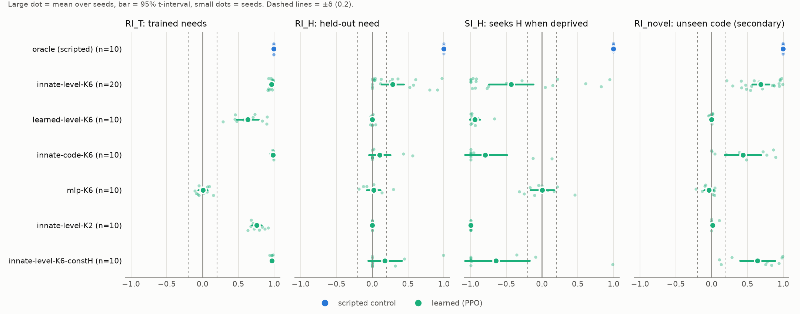
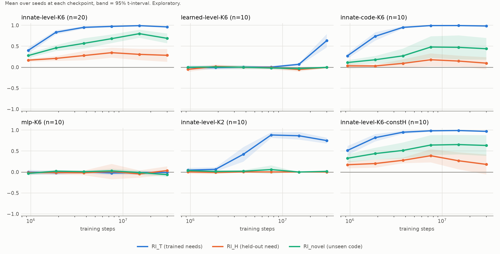
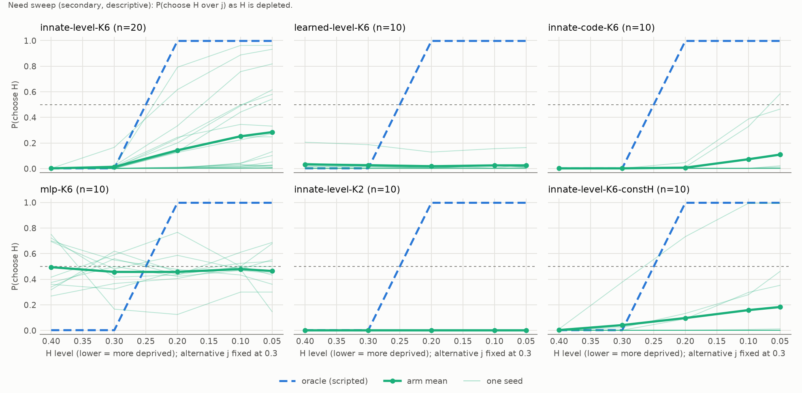

# Can wanting be learned? Held-out-need experiment (v3): results

*Design: `docs/HELDOUT_DESIGN.md`, frozen at bb2726b, plus Amendment 1 (16fc943), both committed before any main run. Raw results and the frozen analysis output: d949e04. Every training and evaluation command: `outputs/v3/COMMANDS.log`.*

How to read this document:
- §1–§4 apply the frozen rule and nothing else.
- §5 scores my own priors.
- §6 is descriptive or exploratory, and says so.
- §7 lists every deviation and correction.
- §8 is my interpretation, kept apart so it can be disagreed with.
- The review log at the end records what an independent check of this write-up changed.

No seed was excluded. No verdict was gated on competence. Nothing was rerun: all 70 runs exited normally on the first attempt.

## 1. Primary outcome

**`innate-level-K6` (20 seeds): inconclusive.**

The primary arm is the best-shot learner:
- a built-in labeled line;
- a value read-out that cannot depend on which nutrient it is;
- six trained needs;
- experience of H's full side.

| | Mean [95% t-interval] | δ-rule reading (δ = 0.2) |
|---|---|---|
| RI_T (trained needs) | +0.96 [+0.95, +0.97] | learned |
| SI_T (trained needs) | +0.93 [+0.90, +0.95] | |
| **RI_H** (held-out need) | **+0.28 [+0.13, +0.44]** | neither present (lower bound < δ) nor negligible (upper bound > δ) |
| RI_spec_H | +0.28 [+0.13, +0.44] | |
| RI_dir_H | +0.28 [+0.13, +0.44] | |
| SI_H | −0.43 [−0.74, −0.12] | small (upper bound < δ) |
| Δ = RI_T − RI_H | +0.68 [+0.53, +0.83] | incomplete (lower bound > δ); sign-flip Holm p < 0.001 |
| Seeds meeting the pre-registered per-seed criterion | **4 / 20** (Clopper–Pearson 0.06–0.44) | |

Rule 1 ("negligible") does not apply, because RI_H's upper bound is 0.44. Rule 2 does not apply either, because RI_H's lower bound is 0.13, below δ. So the verdict is rule 3, **inconclusive**.

The outcome table written in advance (§11) says what that means: "The effect is not resolved with 20 seeds. Numbers and the per-seed count are reported; no claim either way." The verdict stands as that.

The arm did learn need-indexed choice for needs it had experienced (RI_T 0.96, SI_T 0.93), and its mean drive (0.493) matches the scripted oracle's (0.488). So this was a real test, and it came out in the middle.

## 2. What the same intervals show (descriptions, not verdicts)

These use the §6 intervals on quantities the design defines. They add no criteria and change no verdict.

1. **RI_H is above zero, but the rule shows it neither present nor negligible** ([+0.13, +0.44]). Deprivation of H raised P(choose H) from the floor (0.002) to a mean of 0.28.
2. **On average, the deprived agent does not seek H.** SI_H's upper bound is −0.12. With H at 0.05 and the alternative at 0.3, the average agent picks the less-needed trained nutrient in about 72% of its choices.

   The frozen "transfers" verdict requires SI_H's lower bound to be above 0. So if more seeds pushed RI_H's lower bound above δ, the rule would return "revaluation without wanting signature: not seeking". That would hold unless SI_H moved outside its current interval. This is my reading of the rule, not a verdict.
3. **Whatever revaluation occurs is specific and directional.** In every seed, P(H) was at the floor in all three of:
   - `ctrl_H`: H at the set point;
   - `guard_H`: a *different* need deprived;
   - `over_H`: H over-full, outside its training range.

   The agents chose H only when H itself was low. This is why RI_spec_H and RI_dir_H equal RI_H exactly. It also means those two checks were never the binding constraint in this experiment; RI_H and SI_H were.
4. **Not having experienced the need costs most of the effect.** Δ is incomplete (lower bound > δ) in every arm that learned in-distribution (§3).
5. **Seeds differ widely** (Figure 1).
   - By the pre-registered per-seed criterion (RI_H, RI_spec_H and RI_dir_H ≥ 0.5, and SI_H ≥ δ), 4 of 20 seeds transfer: seeds 8, 10, 12 and 16.
   - At the other end, 11 seeds have RI_H ≤ 0.13, nine of them ≤ 0.05.
   - With 200 probes, per-seed probe noise is a few hundredths, so this spread is not measurement noise.
   - A seed sets both the world's codes and the network's initialization and training, so these data cannot say which of the two decides the outcome.



*Figure 1. Every seed of every arm, with the scripted oracle for reference. RI_novel is secondary (§6).*

## 3. Every arm, read by the pre-registered outcome table (§11)

| Arm | Seeds | RI_T | Held-out verdict | RI_H | SI_H | Gap (Δ) verdict | Per-seed count |
|---|---|---|---|---|---|---|---|
| **`innate-level-K6`** | 20 | learned, +0.96 | **inconclusive** | +0.28 [+0.13, +0.44] | −0.43 [−0.74, −0.12] | incomplete, +0.68 | 4/20 |
| `learned-level-K6` | 10 | learned, +0.63 | **negligible** | −0.00 [−0.02, +0.01] | −0.94 [−1.01, −0.87] | incomplete, +0.63 | 0/10 |
| `innate-code-K6` | 10 | learned, +0.98 | **inconclusive** | +0.10 [−0.05, +0.25] | −0.79 [−1.09, −0.49] | incomplete, +0.88 | 0/10 |
| `mlp-K6` | 10 | **negligible**, +0.00 | negligible | +0.02 [−0.08, +0.11] | +0.00 [−0.16, +0.17] | "complete", −0.01 (artifact; below) | 0/10 |
| `innate-level-K2` | 10 | learned, +0.75 | **negligible** | +0.00 [+0.00, +0.00] | −1.00 [−1.00, −1.00] | incomplete, +0.75 | 0/10 |
| `innate-level-K6-constH` | 10 | learned, +0.97 | **inconclusive** | +0.18 [−0.06, +0.41] | −0.64 [−1.11, −0.17] | incomplete, +0.79 | 1/10 |

Competence covariates (reported beside every result, §6):

| Arm | SI_T | Mean drive | Choice rate dep_H / dep_T |
|---|---|---|---|
| `innate-level-K6` | +0.93 | 0.493 | 0.94 / 1.00 |
| `learned-level-K6` | +0.55 | 0.665 | 0.72 / 0.83 |
| `innate-code-K6` | +0.97 | 0.489 | 0.96 / 1.00 |
| `mlp-K6` | −0.05 | 0.728 | 0.09 / 0.34 |
| `innate-level-K2` | +0.51 | 0.238 (not comparable: two depleting nutrients) | 1.00 / 1.00 |
| `innate-level-K6-constH` | +0.94 | 0.494 | 0.87 / 1.00 |
| *scripted `oracle` / `random`* | | *0.488 / 0.842* | |

How §11 reads each arm:

- **`innate-level-K6`**: not resolved; no claim either way.
- **`learned-level-K6`**: learned valuation with a *learned* match did not reach the unexperienced need, at this budget. The arm was still improving in-distribution when the budget ran out: RI_T was 0.07 at 15M steps and 0.63 at 30M (Figure 2). Its held-out result holds at the 30M budget fixed for every arm, and could differ with more training. Its RI_H and RI_novel stayed at zero at every checkpoint while RI_T rose.
- **`innate-code-K6`**: not resolved; 2 of 10 seeds have RI_H above 0.4 and 8 are at or below 0.05.
- **`mlp-K6`**: **this arm failed to test the question.** The MLP did not learn need-indexed choice even for experienced needs (RI_T 0.00 [−0.06, +0.07]), so there was nothing to transfer.
  - This was despite the pre-specified lr 1e-4 (Amendment 1).
  - Its gap verdict is "complete" by the δ rule, but only because RI_T and RI_H are both ≈ 0. It does not mean the MLP transferred.
  - The §11 row for this case was written before the data. It is a failure of my design or budget for this arm, not evidence for or against either theory.
- **`innate-level-K2`**: with two trained needs, no seed ever chose H, even at H = 0.05.
- **`innate-level-K6-constH`**: not resolved.
  - One seed (seed 6) is the cleanest transfer in the experiment: RI_H 0.99, SI_H 0.99. It made a choice in only 36% of dep_H probes; when it chose, it chose H.
  - Two seeds are at 0.32–0.45, and seven at or below 0.05.

## 4. Planned comparisons (paired sign-flip tests on shared seeds, Holm over all 11)

| Comparison | Mean difference | n | Holm p | Reading |
|---|---|---|---|---|
| C1 RI_H: built-in vs learned match | +0.22 | 10 | 0.020 | built-in higher; **confounded** (below) |
| C2 RI_H: level-only vs code + level read-out | +0.11 | 10 | 1.000 | no difference detected |
| C3 Δ: relational vs MLP | +0.76 | 10 | 0.020 | **uninformative** (below) |
| C4 RI_H: six vs two trained needs | +0.22 | 10 | 0.020 | six higher; **confounded** (below) |
| C5 RI_H: H's full side varies vs constant | +0.04 | 10 | 1.000 | no difference detected |
| Δ ≠ 0 within `innate-level-K6` | +0.68 | 20 | < 0.001 (none of 100,000 random sign flips as extreme) | incomplete transfer |
| Δ ≠ 0 within `learned-level-K6`, `innate-code-K6`, `innate-level-K2`, `innate-level-K6-constH` | +0.63 to +0.88 | 10 each | ≤ 0.020 | incomplete transfer |
| Δ ≠ 0 within `mlp-K6` | −0.02 | 10 | 1.000 | (nothing learned) |

**C3 is a flaw in my pre-registration.** I compared on Δ so that an MLP that failed in-distribution could still be compared. But an agent that learns nothing has Δ ≈ 0, which looks the same as complete transfer. The significant p only says the relational agent learned in-distribution and the MLP did not.

**C1 and C4 have a weaker version of the same problem.** Both comparison arms learned the trained needs less well:

| Arm | RI_T |
|---|---|
| primary | 0.96 |
| learned match (C1) | 0.63 |
| two trained needs (C4) | 0.75 |

C1 also differs in learning rate (1e-4 against 3e-4, Amendment 1). Part of each difference may reflect weaker in-distribution learning rather than the ingredient named.

A partial check (descriptive): within each comparison arm, the seeds that learned the trained needs best still show no held-out revaluation.
- Learned match: seeds 3 and 2 have RI_T 0.90 and 0.89, with RI_H 0.00 and 0.01.
- Two trained needs: seed 4 has RI_T 0.92, with RI_H 0.00.

That makes weaker in-distribution learning an unlikely full explanation. It does not remove the confound, and it does nothing about the learning-rate difference.

"No difference detected" for C2 and C5 is not evidence of no effect. With n = 10, a moderate difference would often be missed.

## 5. Scoring my priors

| What I said before any data | Credence | What happened |
|---|---|---|
| Primary verdict: transfers / without signature / negligible / inconclusive | 0.45 / 0.15 / 0.25 / 0.15 | **inconclusive**. Brier score **1.010**; a uniform 0.25 each would have scored 0.75 |
| Primary RI_H, 10% / 50% / 90% quantiles | 0.00 / 0.50 / 0.95 | 0.28: inside, below my median |
| Primary SI_H, 10% / 50% / 90% quantiles | −0.30 / 0.30 / 0.90 | **−0.43: below my 10% quantile** |
| Primary learns in-distribution (RI_T "learned") | 0.85 | yes |
| "Transfers" for `learned-level-K6` / `innate-code-K6` / `mlp-K6` / `innate-level-K2` / `constH` | 0.20 / 0.30 / 0.08 / 0.40 / 0.35 | none transferred: two negligible, two inconclusive, one failed to test |
| `mlp-K6` RI_T "learned" | 0.55 | no |
| C1 (built-in match beats learned) | 0.65 | yes, but confounded (§4) |
| C5 (full-side experience helps) | 0.40 | not detected |

How my priors failed:
- I was too optimistic about transfer: no arm reached "transfers".
- I was too confident that agents which revalued H would also *seek* it.
- I was too confident the primary would resolve; I put only 0.15 on "inconclusive".
- My prior theory from v2 predicted "negligible" for the primary. That wasn't established either.

## 6. Secondary and exploratory results (no verdicts; the design listed these as descriptive)

**Novel-code probe (secondary, §5).** H's item and need token carry a code the agent has never seen.

| Arm | RI_novel | SI_novel | Seeds with RI_novel ≥ 0.5 |
|---|---|---|---|
| `innate-level-K6` | +0.68 [+0.57, +0.80] | +0.37 [+0.14, +0.61] | 14 / 20 |
| `innate-level-K6-constH` | +0.64 | +0.29 | 7 / 10 |
| `innate-code-K6` | +0.44 | −0.12 | 4 / 10 |
| `learned-level-K6` | 0.00 | | |
| `innate-level-K2` | +0.01 | | |
| `mlp-K6` | −0.04 | | |

In the primary arm:
- the smallest RI_novel of any seed is 0.21;
- the paired difference RI_novel − RI_H is +0.40 [+0.26, +0.54];
- two seeds show RI_novel 0.96 and 0.95 with RI_H 0.00.

So the built-in-match agents revalue an item with an *unseen* code far more than H, the nutrient they had experienced but never needed.

This fits the fallback named in the design (§2): a learned, outcome-specific avoidance of H. H items were always mildly aversive in training, because H was never low. That avoidance would compete with a need-reading that otherwise generalizes. **This is a hypothesis, not a finding.** The novel probe has no guard or over-full condition, so a non-specific "approach the unfamiliar when needy" policy could produce the same numbers.

**Need sweep (secondary; Figure 3).** Primary mean P(choose H over j, with j at 0.3):

| H level | 0.4 | 0.3 | 0.2 | 0.1 | 0.05 |
|---|---|---|---|---|---|
| P(choose H) | 0.00 | 0.01 | 0.14 | 0.25 | 0.29 |

The oracle switches fully to H at 0.2 and below. The response is graded and goes in the right direction, but it carries a large constant bias against H. At *equal* need (both at 0.3), H is chosen 1% of the time.

**Training curves (exploratory; Figure 2).**
- Primary RI_H rises early (0.17 at 0.9M steps), peaks at 0.35 at 7.5M, and is 0.28 at the end.
- RI_novel rises to 0.80 at 15M and is 0.68 at the end.
- The gap between novel-code and H revaluation widens over training: 0.11 at 0.9M, 0.40 at the end.
- `innate-level-K2`'s in-distribution RI_T peaked at 0.88 (7.5M) and fell to 0.75.

No tests were run on these curves.



*Figure 2. Mean over seeds at each checkpoint (log scale), with 95% t-interval bands.*



*Figure 3. P(choose H) as H is depleted, per seed and arm mean, with the oracle dashed.*

## 7. Deviations and corrections (complete list)

1. **Wall-clock budget.**
   - Main training took 16.7 hours (07:38 to 00:19). That is above Amendment 1's ~10 hour estimate and above the 14-hour limit the §9 budget rule was meant to respect.
   - Cause: 9 parallel jobs on a machine with 4 performance and 6 efficiency cores. Each job ran at roughly half the pilot's per-job speed (8,360 s per primary run, against ~3,900 s projected from the pilot).
   - With the throughput actually achieved, 30M steps would not have fitted the limit.
   - The 30M budget was frozen before the runs, so I kept it. No run was extended, shortened or stopped, and every arm got the same budget.
2. **`run_heldout.py --shard k/n`** (a978f2e) was added after training and before any held-out assay ran. It is compute only: every evaluation sets its own seeds, so results do not depend on the worker that ran them.
3. **Post-data correction to the analysis output (§10).** The note printed under the Brier score read "0.5 = uniform over 4". A uniform prior over four categories scores 0.75, so the note now says so. The score itself (1.010) and every other number are unchanged. The first run of the analysis, which was never committed, printed: "Brier score of the pre-registered prior on the primary verdict: 1.010 (0 = certain and right; 0.5 = uniform over 4)."
4. **Correction to Amendment 1.** It gave the scripted references' mean drive as "0.44 for `oracle` and 0.85 for `random`". The committed validity files give 0.488 and 0.842; 0.44 is the oracle's lowest seed. The amendment is left as frozen and corrected here. No decision depended on it.
5. **What I saw during training.**
   - No held-out probe was computed until all 70 runs had finished. The last run finished at 00:19:28, and COMMANDS.log records the eight `run_heldout.py learned --shard k/8` workers starting at 00:21:43.
   - During the pilots and the main runs, I did read rows of the training logs while checking progress. These rows include `eaten_held_out`, the number of H items eaten per episode during training. I saw it for the six pilot runs at 10M steps, and for some main runs at around 5M steps.
   - That column is a training statistic, not a probe. No setting was changed after the main launch.
   - The only pilot-based decision, the learning rate in Amendment 1, used pilot RI_T alone, by the pre-specified rule.
6. **Not logged.** Runs of `analyze_v3.py` and `plot_v3.py` are not written to COMMANDS.log. The analysis was run twice, before and after correction 3; the figure script was run once to produce the figures shown.

## 8. What I think this means (interpretation, separate from the results)

- **On the primary question, the pre-registered test did not resolve.** §11 makes no claim, and I make none from the verdict.
- **Outside the verdict, the pre-registered per-seed count (4/20, interval 6–44%) excludes zero.** Some trained networks with a built-in labeled line do revalue a never-needed outcome, and only when that specific need is low. My v2 conclusion, "learned valuation does not generalize to unexperienced needs", is contradicted by that if it is read as "cannot". The test pre-registered for the v2 view did not settle it either way.
- **As a description of the typical learner, the v2 view held up better than my best-shot prior.** On average, even this favorably built agent:
  - still preferred a less-needed familiar item over a badly needed held-out one;
  - revalued held-out needs at about a third of the strength of trained ones.

  With a learned match, or with only two trained needs, held-out revaluation was negligible.
- **The ingredient results are mostly negative, unresolved or confounded:**
  - two trained needs: no seed ever chose H;
  - learned match: did not reach H at this budget, though it also learned the trained needs less well;
  - nutrient-general read-out and full-side experience: no effect detected at n = 10;
  - generic MLP: the question was not tested.
- **The most suggestive pattern is secondary and uncontrolled.** The same agents revalue an unseen code much more than H. If the §6 hypothesis is right, the obstacle is not a failure to generalize need-reading. It is that a learned, outcome-specific aversion is not overridden by a new need.

  Berridge's rats did override exactly that kind of learned aversion to salt the first time they were sodium-depleted. These agents mostly did not. That contrast looks like a sharper question than "learning versus planning".

  Testing it would need its own pre-registration. One option is a novel-code probe with guard and over-full conditions. Another is training in which H items are neutral rather than aversive.
- **What this does not show:** anything about agents outside this toy world and algorithm, or about generic networks without a built-in match.

## 9. Limitations

- A toy world and one RL algorithm (PPO).
- A seed sets both the world's codes and the training run, so the spread in §2 cannot be attributed to either.
- Secondary arms have 10 seeds, which leaves moderate effects in C2 and C5 undetectable.
- C3 was badly designed, and C1 and C4 are confounded by in-distribution learning (§4).
- The novel-code probe has no specificity or directional controls.
- `learned-level-K6` was still improving at the end of its budget, and `mlp-K6` never learned the task.

## Review log (independent check of this write-up, 2026-10-11, after the results)

A separate reviewer recomputed every number from the per-seed files. They checked the commit and command timeline, and looked for spin in either direction. **They found no wrong verdict or interval.**

**Changed:**
- **§8 and the README.** The earlier draft said my v2 conclusion "is wrong as a universal statement", citing "3 of 20" seeds. Both problems:
  - That 3 came from a ≥ 0.8 cutoff chosen after seeing the data. The pre-registered count is 4/20.
  - §11 tied "v2 is wrong" to a *transfers* verdict.

  The claim is now limited to what the count supports.
- **§2.** "Held-out revaluation is not negligible" became "neither present nor negligible", because §6 requires equal evidence for positive and negative claims.
- **§4 and §5.** Added the in-distribution-learning confound for C1 and C4. It is the same logic I had applied only to C3.
  After the review, I added the descriptive partial check on that confound (§4). The reviewer did not see it.
- **Pre-registered outputs I had left out:**
  - SI_T;
  - the MLP's "complete" gap verdict and why it is an artifact;
  - per-arm per-seed counts;
  - the competence covariates table;
  - the Δ interval;
  - the `constH` seed with the cleanest transfer.
- **Factual fixes:**
  - the oracle and random mean drives (correction 4);
  - the RI_novel minimum;
  - end-of-training RI_novel 0.68, not 0.69;
  - a too-narrow description of what I saw during training (deviation 5);
  - the header's "every command" (deviation 6).
- **Wording.** "That didn't happen either" became "wasn't established either". "Most informative" became "most suggestive (secondary, uncontrolled)".

## Reproduce

```bash
python experiments/launch_heldout.py main --steps 30000000 --parallel 9 \
    --learning-rate learned-level-K6=1e-4 mlp-K6=1e-4         # ~17 h on a 10-core laptop
for k in 0 1 2 3 4 5 6 7; do python experiments/run_heldout.py learned --shard $k/8 & done; wait
python experiments/analyze_v3.py                               # verdicts, tables -> outputs/v3/
python experiments/plot_v3.py                                  # exploratory figures
```
